# Murray PTS v2 — class diagram

Generated 2026-10-12 from `src/main/kotlin/mn/murray/pts/` (48 files) and `src/test/kotlin` (7 files).
Diagrams are Mermaid — they render in Qoder/VS Code preview, on GitHub, and at mermaid.live.

| Notation | Meaning in this codebase |
|---|---|
| `<<object>>` | Kotlin `object` — process-wide singleton; no DI container, no interfaces to fake |
| `<<dto>>` | `data class` — immutable value type (domain model, row DTO, or result type) |
| `<<table>>` | Exposed `Table` mirror of a SQLite table: Flyway owns DDL, these own DML |
| `+` / `-` | public / private |
| `..>` | "calls / depends on" |
| `-->` | foreign key or owning relationship, with cardinality and delete rule as the label |
| `_pk` `_fk` `_unique` name suffixes | stand in for the usual PK/FK/UNIQUE annotations, for parser safety |

Kotlin nullability (`String?`) and return types are left out of signatures inside the diagrams; the tables
under each section carry the authoritative versions.

---

## 1. Layer overview

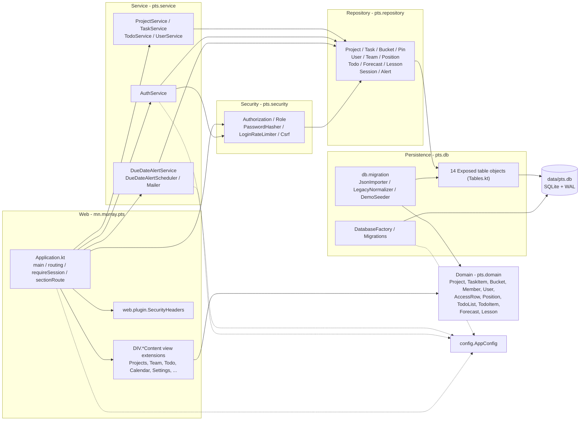

Dependency direction is strictly downward: no repository imports a service, no service imports Ktor. The one
non-obvious edge is `Data.kt` / `DemoData`, a read-only façade the views still use (§11).

---

## 2. Domain model (`pts.domain`)

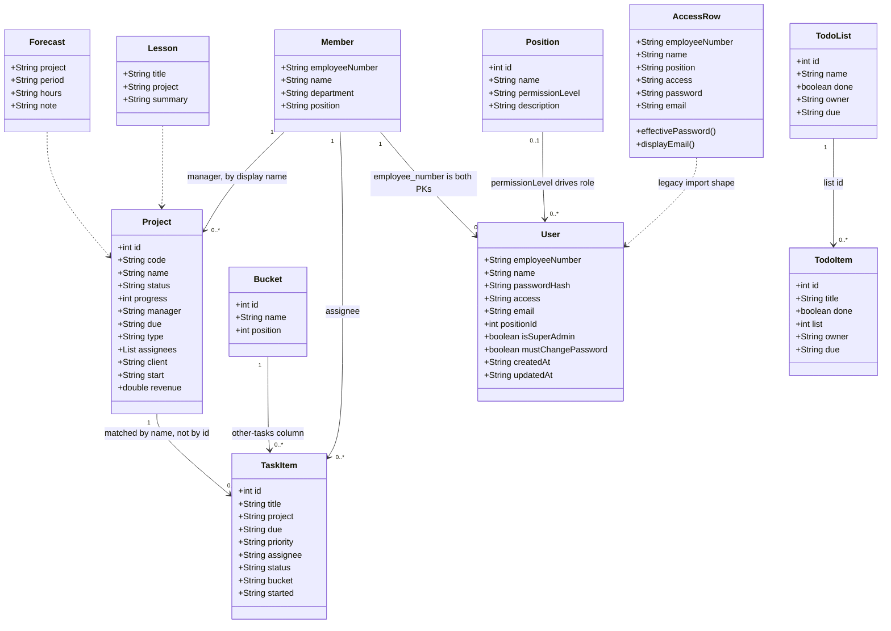

Companions in the same package (top-level, not classes): `PROJECT_TYPES` (the nine category labels),
`TYPE_PREFIX` (label → the letter leading its numbers), `typeLetter()`/`typeLabel()`, `PROJECT_STATUSES`,
`TASK_STATUSES`, `ACCESS_LEVELS`, `PERMISSION_LEVELS`, `TEAM_ROSTER` (hard-coded 23-person seed roster),
`LEGACY_PROJECTS`, `migrateStatus()`, `migrateType()`/`migrateCode()` (pre-V3 labels and `SIT-`/`MFG-`/
`RMS-`/`LAB-` codes), `CODE_PATTERN` with `normalizeProjectCode()`/`isValidProjectCode()`/
`codeMatchesType()`, `nextProjectNumber()`/`nextProjectCode()`, `autoEmail()`. All domain DTOs except
`Bucket` are `@Serializable`, which is what lets the same types serve the legacy JSON store and the
SQLite rows.

Three field names do not say what they mean:

- `Project.name` is the **description** typed into the create form — there is no separate title field.
- `Project.due` is the **end date**. The column is called `due` in the DB and the Calendar and the
  due-date alerts key off it, so the V3 migration added `start_date` beside it instead of renaming it.
- `Project.code` must lead with its category letter (`S-01` for Site projects), which is what
  `codeMatchesType()` checks on the way in.

Two asymmetries to know before editing:

- `Project.manager` and `TaskItem.project` hold **names**, while the DB holds `manager_emp_no` / `project_id`.
  `ProjectRepository.map()` and `TaskRepository.map()` translate via `empNames()` / `projectNames()` /
  `bucketNames()` helper maps — one extra query per call, no SQL join.
- `User` (v2: hashed, position-linked, timestamped) and `AccessRow` (legacy: plaintext `password`) describe the
  same account. `AccessRow` survives only for the JSON importer and for the Access-control / Settings views,
  which get it from `UserService.accessRows()`.

---

## 3. Persistence — the 14 Exposed `<<table>>` objects (this is also the ER diagram)

All in `db/Tables.kt`; DDL owned by Flyway (`resources/db/migration/V1__init.sql`,
`V2__due_date_alerts.sql`, `V3__project_categories.sql`).
Booleans are SQLite INTEGER 0/1; timestamps are ISO-8601 TEXT in UTC.

### 3a. People, access, sessions

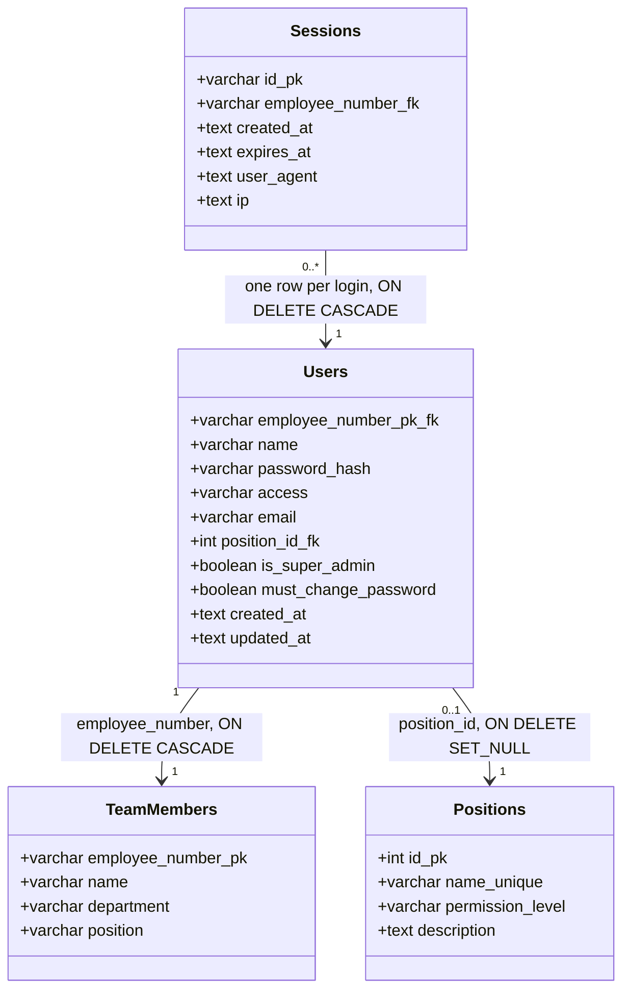

### 3b. Work

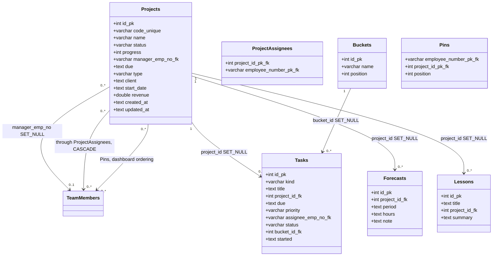

`Tasks.kind` is a discriminator, not a table split: `ASSIGNED` rows feed the assigned-tasks board and
`OTHER` rows feed the other-tasks board, and only `OTHER` uses `bucket_id`.

### 3c. Personal to-do and the alert ledger

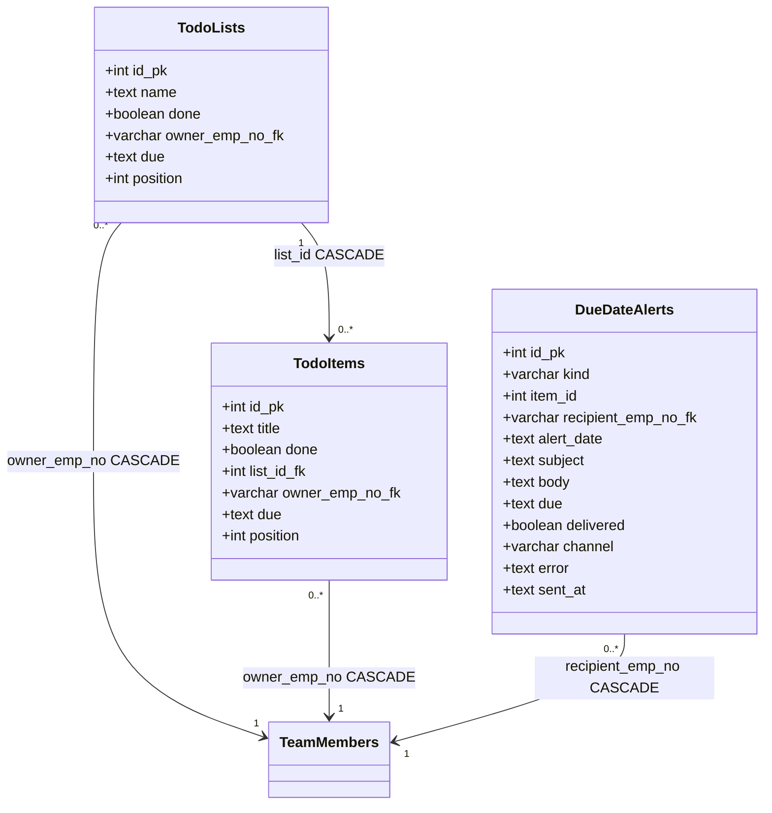

`due_date_alerts` carries `UNIQUE (kind, item_id, recipient_emp_no, alert_date)` (added in V2). That index *is*
the "at most one alert per person per item per day" rule, and it is what makes the rule survive a restart or a
repeated "run now". Failed sends and log-only dry runs are recorded with `delivered = false` on purpose, so the
ledger shows what was attempted, not only what landed.

---

## 4. Data-access layer (`pts.repository`) — stateless singletons

```mermaid
classDiagram
  class ProjectRepository {
    +findAll()
    +findById(id)
    +findByType(type)
    +idByName()
    +insert(code,name,status,progress,managerEmpNo,due,type,client,start,revenue)
    +update(id,name,status,progress,managerEmpNo,due,type,client,start,revenue)
    +setManager(id,empNo)
    +setProgress(id,progress)
    +setStatus(id,status)
    +addAssignee(id,empNo)
    +removeAssignee(id,empNo)
    +delete(id)
    +existingCodes()
    +suggestedCodes()
    -map(r,empNames,assignees)
    -empNames()
    -assigneesByProject()
  }
  class TaskRepository {
    +findByKind(kind)
    +findById(id)
    +assigneeOf(id)
    +insert(kind,title,projectId,due,priority,assigneeEmpNo,status,bucketId,started)
    +updateStatus(id,status)
    +setBucket(id,bucketId)
    +delete(id)
  }
  class BucketRepository {
    +findAll()
    +names()
    +idByName()
    +insert(bucketName)
    +delete(id)
  }
  class PinRepository {
    +pinnedProjectIds(empNo)
    +isPinned(empNo,projectId)
    +toggle(empNo,projectId)
  }
  class UserRepository {
    +findAll()
    +findByEmpNo(empNo)
    +count()
    +mustChangePassword(empNo)
    +insert(employeeNumber,name,passwordHash,access,email,positionId,isSuperAdmin,mustChangePassword)
    +updatePasswordHash(empNo,hash,mustChange)
    +updateEmail(empNo,email)
    +updateAccess(empNo,access)
    +updatePosition(empNo,positionId)
    +updateName(empNo,name)
    +delete(empNo)
  }
  class TeamRepository {
    +findAll()
    +findByEmpNo(empNo)
    +findByName(name)
    +empNoByName()
    +upsert(member)
    +delete(empNo)
  }
  class PositionRepository {
    +findAll()
    +findById(id)
    +findByName(name)
    +insert(positionName,level,description)
    +update(id,positionName,level,description)
    +delete(id)
  }
  class TodoRepository {
    +listsByOwner(empNo)
    +allLists()
    +itemsByOwner(empNo)
    +allItems()
    +itemsByList(listId)
    +listOwner(listId)
    +itemOwner(itemId)
    +insertList(name,owner,due)
    +insertItem(title,listId,owner,due)
    +toggleItem(itemId)
    +setItemDue(itemId,due)
    +deleteItem(itemId)
    +toggleList(listId)
    +setListDue(listId,due)
    +renameList(listId,name)
    +deleteList(listId)
    +reorderLists(owner,orderedIds)
    +moveList(listId,up)
    +ListsByOder(empNo)
  }
  class ForecastRepository {
    +findAll()
  }
  class LessonRepository {
    +findAll()
  }
  class SessionRepository {
    +create(employeeNumber,ttlHours,userAgent,ip)
    +findValid(token)
    +revoke(token)
    +revokeAllFor(employeeNumber)
    +purgeExpired()
  }
  class AlertRepository {
    +openProjects()
    +openTasks()
    +displayNames()
    +emailsByEmpNo()
    +keysForDay(alertDate)
    +key(kind,itemId,recipientEmpNo)
    +record(kind,itemId,recipientEmpNo,alertDate,subject,body,due,delivered,channel,error,sentAt)
    +recent(limit)
    +forDay(alertDate)
    +purgeOlderThan(cutoffDate)
    -mapLedger(r)
  }

  ProjectRepository --> Projects
  ProjectRepository --> ProjectAssignees
  ProjectRepository --> TeamRepository : emp_number to name
  TaskRepository --> Tasks
  TaskRepository --> BucketRepository : bucket id to name
  TaskRepository --> ProjectRepository : project id to name
  PinRepository --> Pins
  UserRepository --> Users
  TeamRepository --> TeamMembers
  PositionRepository --> Positions
  TodoRepository --> TodoLists
  TodoRepository --> TodoItems
  ForecastRepository --> Forecasts
  LessonRepository --> Lessons
  SessionRepository --> Sessions
  AlertRepository --> DueDateAlerts
  AlertRepository --> Projects : candidate rows
  AlertRepository --> Tasks : candidate rows
```

Every one of these is an `object`, and every public method opens its **own** `transaction { }` — there is no
unit of work, so a multi-step write (project insert + assignee rows) is two transactions.

File map: `ProjectRepositories.kt` → ProjectRepository, PinRepository, BucketRepository, TaskRepository ·
`PeopleRepositories.kt` → PositionRepository, TeamRepository, UserRepository ·
`ContentRepositories.kt` → ForecastRepository, LessonRepository, TodoRepository ·
`AlertRepository.kt` → AlertRepository + ProjectDueRow, TaskDueRow, AlertLedgerRow ·
`SessionRepository.kt` → SessionRepository + SessionRecord.

---

## 5. Service layer (`pts.service`)

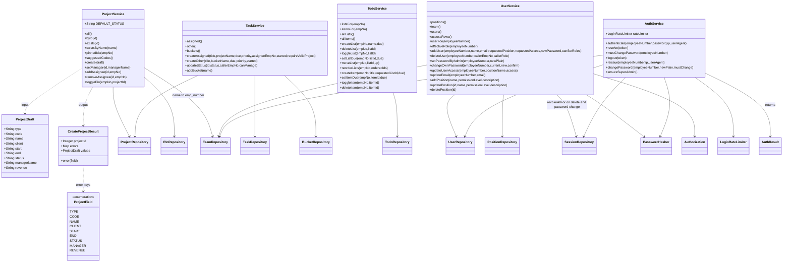

Responsibility notes that the arrows don't show: `ProjectService.create(draft)` is the whole validation
surface for the create form — category in `PROJECT_TYPES`, number normalised, well-formed, letter-matching
its category and unused (`ProjectRepository.existingCodes()`), description non-blank, both dates ISO and not
reversed, manager a roster member, revenue parseable and non-negative — and it writes **nothing** unless all
of those pass, returning one message per `ProjectField` so the view can put each under its own input.
`suggestedCodes()` asks the repository once for all nine offers, and `DEFAULT_STATUS` ("Not started") is
applied server-side so the default holds even without the select. `TaskService` owns the `ASSIGNED` /
`OTHER` kind choice and the "a Viewer may move only their own task" rule inside
`updateStatus(..., callerEmpNo, canManage)`;
`TodoService` is the ownership boundary for personal boards (every method takes `empNo` and refuses
cross-owner writes); `UserService` returns the `PasswordStatus` enum from `Settings.kt` as its error channel;
`AuthService.changePassword()` revokes **all** sessions for the user, and `reissue()` gives the caller a fresh
cookie so a self-service change doesn't log them out of their own form.

`AuthService.ensureSuperAdmin()` runs on every boot and will insert a `team_members` placeholder first,
because `users.employee_number` has a FK into it — a fresh DB cannot create the admin account otherwise.

---

## 6. Security, roles, and the request gate

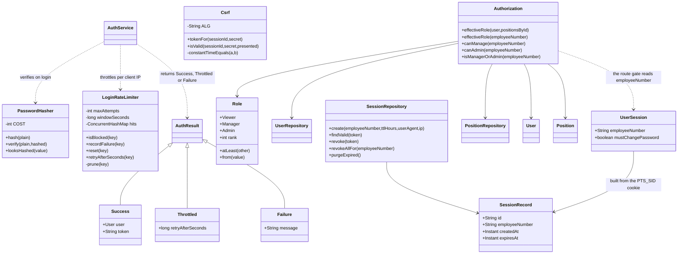

Role resolution order (locked v2 decision, in `Authorization`): `isSuperAdmin` → Admin; else the linked
position's `permissionLevel`; else the account's own `access`; else Viewer. `LoginRateLimiter` is in-process
and IP-keyed, with bounds from `AppConfig.loginMaxAttempts` / `loginWindowSeconds`.

`requireSession()` is a private extension in `Application.kt`, not a class in `security/` — the gate lives
with the routing:

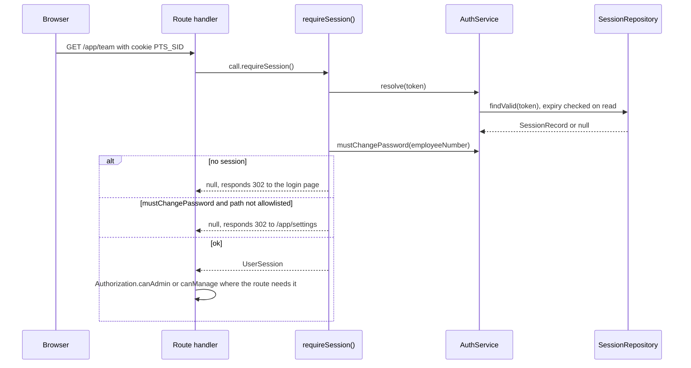

Allowlist while `mustChangePassword` is set: `/app/settings` and `POST /app/settings/password`. `/logout` is
deliberately not gated, so a locked-out user can always sign out. *(Stage 99 retired the gate, the allowlist and the
password route: `requireSession` now answers only "is there a session".)*

**Known gap:** `Csrf` is implemented and unit-tested but wired into no form and no route — POST protection
currently rests on the `SameSite=Lax` session cookie. Open decision, tracked in README → Known gaps.

---

## 7. Due-date alert subsystem

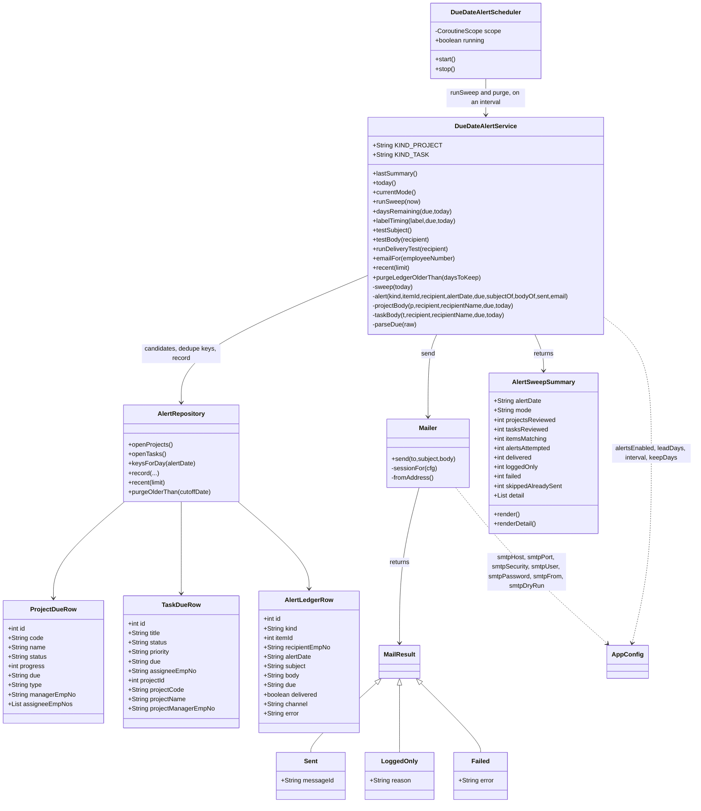

Three behaviours the diagram can't show:

- The scheduler owns one `CoroutineScope(SupervisorJob() + Dispatchers.IO)` loop, started by `main()` and
  cancelled by the shutdown hook (which also closes the Hikari pool). A failed sweep is caught and logged so
  the daily heartbeat survives, while `CancellationException` is rethrown. **Single-node by design** — two
  processes sharing one `data/pts.db` get dedupe from the ledger's UNIQUE index, but the check-then-insert
  pair is not atomic across processes, so overlapping sweeps on separate DB files can mail twice.
- `runDeliveryTest()` (behind `POST /app/alerts/test`) calls `Mailer.send()` directly and writes **no ledger
  row**, so it can be re-run immediately after fixing a credential without spending the day's alert budget.
- `LoggedOnly` is the dry-run / unconfigured path and `Failed` is a real SMTP rejection; only `Sent` records
  `delivered = true`. `currentMode()` is what those three endpoints print so an operator sees which case they
  are in.

---

## 8. Web layer — routes, session helpers, and the view functions

```mermaid
classDiagram
  class Application {
    +main()
    -bootstrapDatabase()
    -setSessionCookie(token)
    -clientIp()
    -isFetch()
    -sectionRoute(path,section,title,content)
    -respondLogin(error)
    +currentSession()
    -requireSession()
    -lanAddresses()
  }
  class UserSession {
    +String employeeNumber
    +boolean mustChangePassword
  }
  class SecurityHeaders {
    +onCall(call)
  }
  class DashboardCommon {
    +appPage(session,section,title,block)
    +navItems(employeeNumber)
    +ICONS
  }
  class NavItem {
    +String id
    +String path
    +String label
    +String icon
    +int count
  }
  class Views {
    +HTML_loginPage(error)
    +BODY_themeToggle()
    +BODY_themeScript()
  }
  class ProjectsKt {
    +DIV_projectsContent(session,typeFilter,form)
    -DIV_projectCreateModal(state)
    +DIV_projectTable(shown,session)
    +DIV_projectDetailContent(session,project,canManage)
    -formatRevenue(value)
  }
  class ProjectForm {
    +ProjectDraft values
    +Map errors
    +Map suggestions
    +isOpen
    +error(field)
  }
  ProjectsKt ..> ProjectForm : renders the modal
  class TasksKt {
    +DIV_assignedTasksContent(session,canManage)
    +DIV_taskRow(task,session,canManage,showStatus)
    +DIV_tasksContent(items,caption)
  }
  class PeopleKt {
    +DIV_teamContent(canManage)
    +DIV_accessContent(canAdmin,canManage,currentEmployeeNumber,passwordStatus,statusDetail)
  }
  class BoardsKt {
    +DIV_calendarContent(session)
    +DIV_todoContent(session)
    +DIV_forecastsContent()
    +DIV_lessonsContent()
  }
  class SettingsKt {
    +DIV_settingsContent(session,passwordStatus)
    +DIV_flashBanner(status,detail)
    +int MIN_PASSWORD_LENGTH
  }
  class PasswordStatus {
    +boolean isError
    +String text
  }

  Application --> UserSession
  Application --> SecurityHeaders : install
  Application --> ProjectsKt : sectionRoute and respondHtml
  Application --> TasksKt
  Application --> PeopleKt
  Application --> BoardsKt
  Application --> SettingsKt
  Application --> Views : login page
  ProjectsKt --> DashboardCommon : wrapped by appPage
  TasksKt --> DashboardCommon
  PeopleKt --> DashboardCommon
  BoardsKt --> DashboardCommon
  SettingsKt --> DashboardCommon
  SettingsKt --> PasswordStatus : renders
  PeopleKt --> PasswordStatus : renders
  Application --> AuthService
  Application --> ProjectService
  Application --> TaskService
  Application --> TodoService
  Application --> UserService
  Application --> DueDateAlertService
  Application --> DemoData : reads aggregates
```

Because each page's markup is a set of top-level `kotlinx.html` extension functions, Kotlin compiles one
synthetic facade class per file — `ProjectsKt`, `TodoKt`, `ForecastsKt`, `OtherTasksKt`, `LessonsKt`,
`AccessControlKt`, `SettingsKt`, `CalendarKt`, `TeamKt`, `AssignedTasksKt`, `ViewsKt`, `DashboardCommonKt`.
A page's class is loaded on that page's **first** request, which is exactly why replacing the jars under a
running `build/install/` dist makes only the not-yet-visited pages throw `NoClassDefFoundError`.

`SecurityHeaders` (a real Ktor plugin, `createApplicationPlugin`) sets `X-Content-Type-Options`,
`X-Frame-Options`, `Referrer-Policy`, `Permissions-Policy`, a CSP that allows `style-src-attr` but no inline
`<style>`/`<script>`, and HSTS when `AppConfig.isProduction`.

### Route inventory

Every `/app/**` handler begins with `call.requireSession() ?: return@…`; rows marked **A** / **M** add an
`Authorization.canAdmin` / `canManage` check.

| Group | Routes | Collaborators used by the handler |
|---|---|---|
| Anonymous | `GET /`, `POST /login`, `GET /logout` | `AuthService.authenticate` / `logout`, `setSessionCookie`, `loginPage` |
| Shell | `GET /app` → 302 `/app/projects`, `staticResources("/static")`, legacy logo redirect | — |
| Pages | `GET /app/projects`, `/app/projects/{id}`, `/app/assigned-tasks`, `/app/calendar`, `/app/team`, `/app/forecasts`, `/app/lessons`, `/app/other-tasks`, `/app/todo`, `/app/access-control`, `/app/settings` | `DemoData` + `ProjectService`, `TaskService`, `TodoService`, `UserService`, `Authorization` → the `DIV.*Content` functions above |
| Projects | `POST /app/projects` *(no role gate — form → `ProjectDraft`; on success 302 to the new project, on rejection the same page with the modal open)*, `/{id}/manager` **M**, `/{id}/assignees/add` **M**, `/{id}/assignees/remove` **M**, `/{id}/pin` *(no role gate)* | `ProjectService.create` / `suggestedCodes`, `ProjectForm` |
| Tasks | `POST /app/assigned-tasks` **M**, `/app/other-tasks` *(no role gate)*, `/app/other-buckets` *(no role gate)*, `/app/tasks/status` *(canManage is passed into the service, which also checks ownership)*, `/app/team/assign` **M** | `TaskService`, `TaskRepository`, `TeamRepository` |
| To-do | `POST /app/todo/lists`, `/lists/{id}/delete`, `/lists/{id}/toggle`, `/lists/{id}/move`, `/lists/reorder`, `/app/todo`, `/lists/{id}/due`, `/app/todo/{id}/due`, `/{id}/toggle`, `/{id}/delete` *(all no role gate)* | `TodoService` (owner-scoped: every method takes `empNo`) |
| Access control | `POST /app/access-control` **M** (and only **A** may set a role, via `canSetRoles`), `/delete` **M**, `/password` **A**, `/update` **A** | `UserService`, returns `PasswordStatus` |
| Positions | `POST /app/positions` **A**, `/update` **A**, `/delete` **A** | `UserService`, `PositionRepository` |
| Settings | `POST /app/settings/email` *(self **or** A)* | `UserService.updateEmail` (a password is set from the Team sheet's `POST /app/settings/employee/save`, admin only) |
| Alerts | `POST /app/alerts/run` **A**, `POST /app/alerts/test` **A**, `GET /app/alerts/recent` **A** | `DueDateAlertService` on `Dispatchers.IO`; plain-text responses for curl |

---

## 9. Boot and bootstrap path

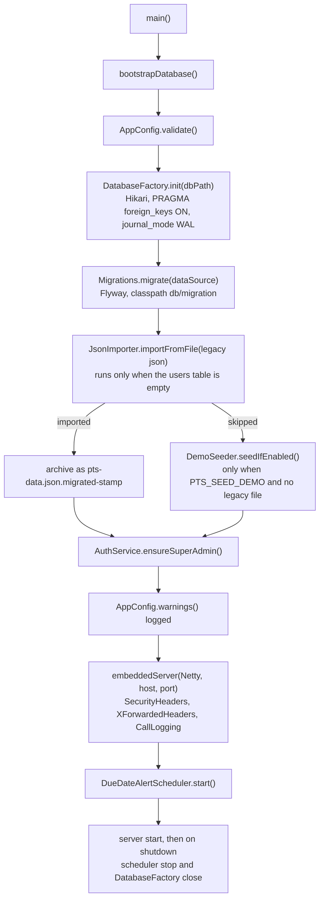

`JsonImporter` details that matter to the classes around it: `shouldImport()` = legacy file exists **and**
`databaseIsEmpty()`; `import(PtsData)` runs inside one `transaction`, first through
`LegacyNormalizer.normalize()` (the 11 legacy-migration steps), then hashes each `AccessRow.effectivePassword()`
with `PasswordHasher` — the plaintext never reaches the DB — and inserts positions → team → users → projects →
assignees → buckets → tasks → forecasts → lessons → todo lists → todo items → pins, returning an
`ImportSummary` of per-table counts plus `imported` / `skipped` / `reason`. Corrupt JSON is skipped and the
file is left in place for inspection; a successful import renames the file, so it cannot run twice.
`DemoSeeder` funnels the demo `PtsData` through the same importer, which is how a seeded DB ends up in exactly
the shape a migrated one has.

---

## 10. Configuration surface — `pts.config.AppConfig` (`<<object>>`)

Precedence: **JVM system property → OS environment → `.env` → default**, through `resolve` / `resolveInt` /
`resolveBool`. `validate()` hard-fails production on a short session secret; `warnings()` is advisory and is
logged on every boot; `summary()` prints the startup block.

| Group | Accessors | Env keys |
|---|---|---|
| Server | `port` `host` `environment` `isProduction` `trustProxy` | `PTS_PORT` `PTS_HOST` `PTS_ENV` `PTS_TRUST_PROXY` |
| Persistence | `dbPath` `legacyJsonPath` `seedDemo` `dataDir` | `PTS_DB_PATH` `PTS_DATA_FILE` `PTS_SEED_DEMO` `PTS_DATA_DIR` |
| Security | `sessionSecret` `sessionCookieName` `sessionTtlHours` `secureCookies` `loginMaxAttempts` `loginWindowSeconds` | `PTS_SESSION_SECRET` `PTS_SESSION_COOKIE` `PTS_SESSION_TTL_HOURS` `PTS_SECURE_COOKIES` `PTS_LOGIN_MAX_ATTEMPTS` `PTS_LOGIN_WINDOW_SECONDS` |
| Admin bootstrap | `superAdminEmpNo` `superAdminBootstrapPassword` | `PTS_ADMIN_EMPNO` `PTS_ADMIN_PASSWORD` |
| Logging | `logDir` `logLevel` `logRequests` | `PTS_LOG_DIR` `PTS_LOG_LEVEL` (system property / OS env **only**) · `PTS_LOG_REQUESTS` |
| Alerts | `alertsEnabled` `alertLeadDays` `alertIntervalHours` `alertStartupDelaySeconds` `alertLedgerKeepDays` | `PTS_ALERTS_ENABLED` `PTS_ALERT_LEAD_DAYS` `PTS_ALERT_INTERVAL_HOURS` `PTS_ALERT_STARTUP_DELAY_SECONDS` `PTS_ALERT_LEDGER_KEEP_DAYS` |
| SMTP | `smtpDryRun` `smtpHost` `smtpPort` `smtpSecurity` `smtpUsername` `smtpPassword` `smtpFrom` `smtpConfigured` | `PTS_SMTP_DRY_RUN` `PTS_SMTP_HOST` `PTS_SMTP_PORT` `PTS_SMTP_SECURITY` `PTS_SMTP_USERNAME` `PTS_SMTP_PASSWORD` `PTS_SMTP_FROM` |

No class reads `.env` directly except `AppConfig`, and no route reads an env var — which is why a test boot
must pass real environment variables (Gradle `-D` properties do not reach the forked application JVM).
Two deliberate exceptions to the four-level precedence: `logDir` / `logLevel` skip `.env` entirely, because
Logback configures itself from the real environment before any Kotlin runs, and
`superAdminBootstrapPassword` reads `PTS_ADMIN_PASSWORD` from property / env / `.env` but treats blank as
absent. `validate()` returns immediately unless `isProduction`, and then throws for a default or short
(< 32 char) session secret; `warnings()` is not production-gated and is logged on every boot.

---

## 11. Legacy compatibility shim (`Data.kt`)

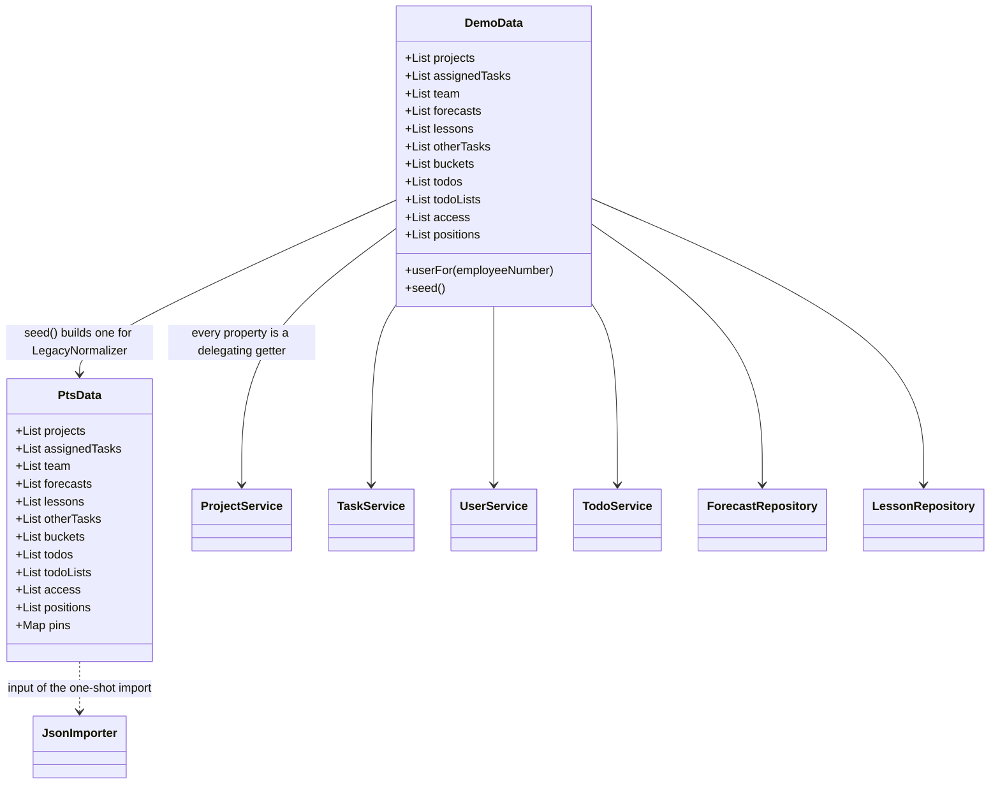

`PtsData` is `@Serializable` and exists only so `JsonImporter` can read a legacy JSON export; `DemoData` keeps
the old `DemoData.projects` call sites in the views compiling while every property resolves through a
DB-backed service. It is a read-only façade, not a store — nothing writes through it. `memberEmail()` and
`pinnedIds()` are the two remaining top-level helpers in the same file, both delegating.

---

## 12. Asymmetries and watch-outs found while mapping

Observations from the code, not style opinions:

- **Singleton-only architecture, no injection seam.** 30 `object` singletons call each other directly (plus
  the 14 Exposed table objects, and 25 `data class` types), so the
  test suite runs against real SQLite files (`MigrationSmokeTest`, `FreshDatabaseBootstrapTest`,
  `JsonImporterTest`, `SecurityTest`, `AuthServiceTest`, `DueDateAlertServiceTest`,
  `MustChangePasswordTest`) instead of fakes. Nothing depends on a DB mock, which is a feature — but adding
  an interface just to fake something would change call sites everywhere.
- **No unit of work.** Each repository method is its own `transaction { }`. `ProjectService.create()` is a
  single insert today, but its duplicate-number check (`ProjectRepository.existingCodes()`) and that insert
  are two commits, so two people submitting the same number at the same moment both pass validation and the
  loser gets the `projects.code` UNIQUE violation (an unhandled 500, not a field message) rather than
  "already used". Add a project and its assignees through two routes and the same seam can leave a project
  without assignees.
- **Dead typo'd duplicate:** `TodoRepository.ListsByOder(empNo)` (`ContentRepositories.kt:91`) is a near-copy
  of `listsByOwner(empNo)` with zero callers in `src/main`. Flagged in the diagram above; left untouched here
  because this was a documentation task.
- **Two `effectiveRole` overloads in `Authorization`.** The `(employeeNumber)` form re-queries user + position
  on every call; the `(user, positionsById)` form is the one to use in loops. `UserService.effectiveRole()`
  just forwards to it.
- **`SessionRepository.purgeExpired()` has no caller in `src/main`** — expiry is enforced at read time inside
  `findValid()`, so expired rows accumulate until something sweeps them. The shutdown hook only stops the
  scheduler and closes the pool.
- **Several write routes are session-gated but not role-gated** (`§8`): `POST /app/projects`,
  `/app/projects/{id}/pin`, `/app/other-tasks`, `/app/other-buckets` and all to-do endpoints. A Viewer can
  therefore create a project row and a bucket; the kanban `tasks/status` route is the one that delegates the
  Manager-or-own-task decision to `TaskService.updateStatus()`. If the intent was Manager-only project
  creation, that guard is missing rather than misplaced.
- **`AccessRow.password` is a plaintext field** that only the importer populates and only `User`'s
  `passwordHash` persists. New code should not read it.
- **`Csrf` unwired** (§6) — a known, declared gap rather than an oversight.
- **`Sessions.id` is the cookie value** and expiry is enforced at read time in `findValid()`, with
  `purgeExpired()` as the sweep; nothing deletes rows lazily beyond that.
- **`Tasks.kind` discriminator over table split** means the assigned and other boards share one repository;
  only `OTHER` rows use `bucket_id`, so `TaskRepository.map()` tolerates a null bucket.
- **`isFetch()` / `clientIp()` are private extensions in `Application.kt`** rather than in `web/`, so a future
  second route file has to move them before it can use them.

---

## 13. File → type inventory

| File | Public types declared |
|---|---|
| `Application.kt` | `UserSession`, `main()`, `currentSession()`, private `bootstrapDatabase` / `requireSession` / `sectionRoute` / `setSessionCookie` / `clientIp` / `isFetch` / `respondLogin` / `lanAddresses` |
| `config/AppConfig.kt` | `AppConfig` |
| `db/Tables.kt` | `Positions`, `TeamMembers`, `Users`, `Projects`, `ProjectAssignees`, `Buckets`, `Tasks`, `Forecasts`, `Lessons`, `TodoLists`, `TodoItems`, `Pins`, `Sessions`, `DueDateAlerts` |
| `db/DatabaseFactory.kt`, `db/Migrations.kt` | `DatabaseFactory`, `Migrations` |
| `db/migration/JsonImporter.kt` | `JsonImporter`, `ImportSummary` |
| `db/migration/LegacyNormalizer.kt`, `db/migration/DemoSeeder.kt` | `LegacyNormalizer`, `DemoSeeder` |
| `domain/*.kt` | `Project`, `TaskItem`, `Bucket`, `Member`, `Position`, `User`, `AccessRow`, `TodoList`, `TodoItem`, `Forecast`, `Lesson` + the constant/helper sets listed in §2 |
| `repository/ProjectRepositories.kt` | `ProjectRepository`, `PinRepository`, `BucketRepository`, `TaskRepository` |
| `repository/PeopleRepositories.kt` | `PositionRepository`, `TeamRepository`, `UserRepository` |
| `repository/ContentRepositories.kt` | `ForecastRepository`, `LessonRepository`, `TodoRepository` |
| `repository/AlertRepository.kt` | `AlertRepository`, `ProjectDueRow`, `TaskDueRow`, `AlertLedgerRow` |
| `repository/SessionRepository.kt` | `SessionRepository`, `SessionRecord` |
| `service/AuthService.kt` | `AuthService`, `AuthResult` (+ `Success` / `Throttled` / `Failure`) |
| `service/ProjectService.kt`, `TaskService.kt`, `TodoService.kt`, `UserService.kt` | the four matching `object`s |
| `service/DueDateAlertService.kt` | `DueDateAlertService`, `AlertSweepSummary` |
| `service/DueDateAlertScheduler.kt` | `DueDateAlertScheduler` |
| `service/Mailer.kt` | `Mailer`, `MailResult` (+ `Sent` / `LoggedOnly` / `Failed`) |
| `security/Authorization.kt`, `Role.kt`, `PasswordHasher.kt`, `LoginRateLimiter.kt`, `Csrf.kt` | `Authorization`, `Role`, `PasswordHasher`, `LoginRateLimiter`, `Csrf` |
| `web/plugin/SecurityHeaders.kt` | the `SecurityHeaders` Ktor plugin |
| `Data.kt`, `DashboardCommon.kt`, `Views.kt` | `PtsData`, `DemoData`, `NavItem`, `navItems()`, `appPage()`, `loginPage()` |
| `Projects.kt`, `AssignedTasks.kt`, `OtherTasks.kt`, `Team.kt`, `AccessControl.kt`, `Todo.kt`, `Calendar.kt`, `Forecasts.kt`, `Lessons.kt`, `Settings.kt` | the `DIV.*Content` view functions per §8; `PasswordStatus` in `Settings.kt`; private `UserRow` in `AccessControl.kt` |

---

### How this was produced, and what it does not prove

Every class, field, method and edge above was read out of the source files on 2026-10-12 (`grep` over the
declarations, then full reads of `Tables.kt`, `domain/*`, `security/*`, `AuthService.kt`, and the alert
routes). Relationships are the actual imports/calls in the code, not a target design.

Not verified: the diagrams were not rendered through a Mermaid engine here, so if a block fails to parse in
your viewer, the usual suspects are the `..>` dependency arrows and the cardinality labels — the content of
each block is plain enough to read as a list either way.
